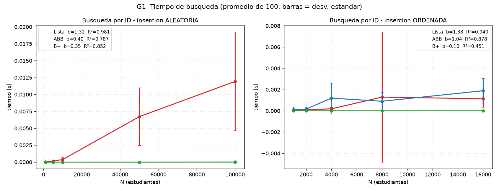
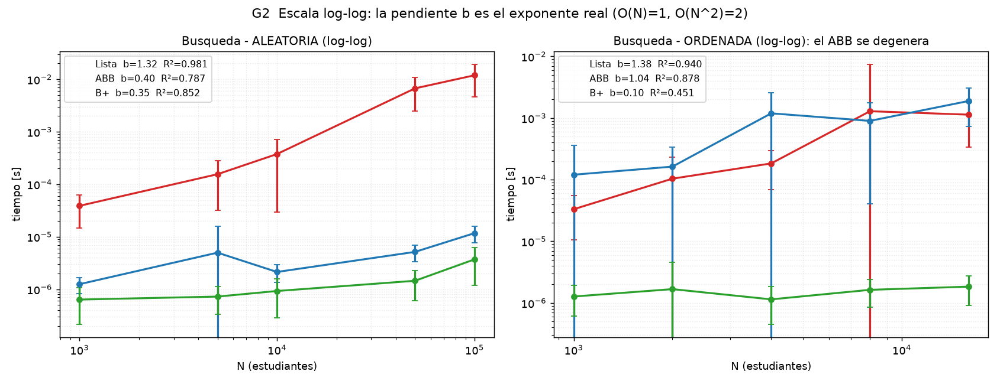
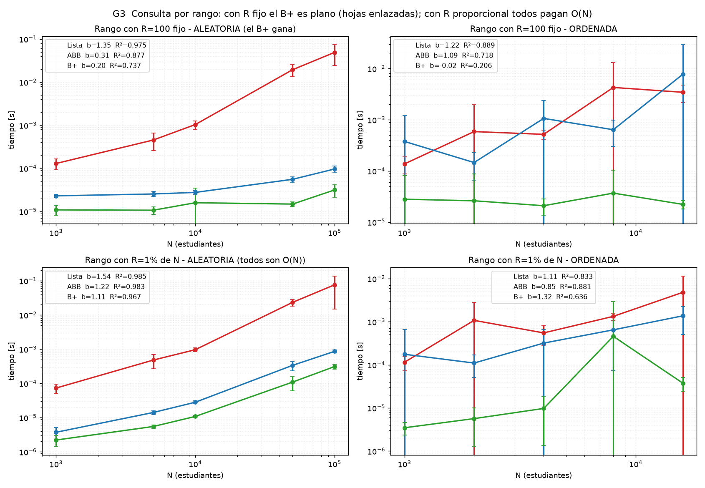
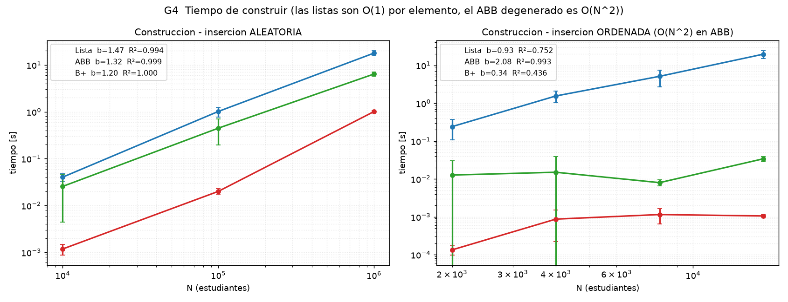
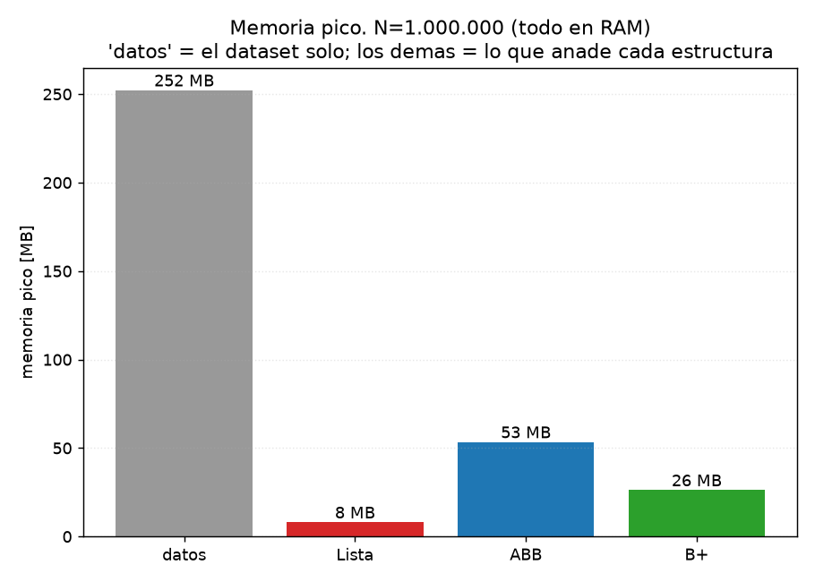

# Laboratorio 3 — Sistema de búsqueda de estudiantes: Lista vs ABB vs Árbol B+

**Estudiante:** Kevin Pantoja <kevin.pantojac@udea.edu.co>

---

## 1. Problema y objetivo

Una institución educativa necesita administrar la información de sus estudiantes. Cada registro contiene **ID** (matrícula única), **nombre**, **edad** y **promedio**. El sistema debe permitir:

1. **Buscar** un estudiante por su ID.
2. **Insertar** un nuevo estudiante.
3. **Listar** todos los estudiantes en orden ascendente de ID.

Además de estas tres operaciones, se evaluó la **búsqueda por rango de IDs** (`buscar_rango(lo, hi)`): obtener todos los estudiantes con ID entre `lo` y `hi` inclusive.

**Objetivo:** estudiar experimentalmente cómo el tiempo de esas operaciones **escala al aumentar el número de estudiantes N**, en tres estructuras de datos (**lista**, **árbol binario de búsqueda** y **árbol B+**), con dos órdenes de inserción (IDs aleatorios y IDs ordenados), y contrastar los resultados con la complejidad teórica mediante análisis estadístico. Se busca entender también **por qué la realidad se aparta de la teoría** (costos constantes, memoria caché, ruido de medición) y qué implica cada estructura en memoria.

## 2. Contenido del repositorio

| Archivo | Qué contiene |
|---|---|
| `busqueda_estudiantes.py` | Generación de estudiantes y las tres estructuras (Lista, ABB, B+), todas con la misma interfaz (`insertar`, `buscar`, `listar`, `buscar_rango`, `altura`). Incluye una prueba rápida de correctitud al ejecutarlo. |
| `experimento.py` | Los 5 experimentos, la disciplina de medición (piso del cronómetro, GC, calentamiento, verificaciones), el análisis de pendientes y la generación de gráficas. |
| `resultados.csv` | Mediciones crudas: media, mediana, desviación, mín/máx, nº de repeticiones y altura por cada punto, más la memoria. |
| `g1_busqueda_lineal.png` … `g5_memoria.png` | Las 5 gráficas del informe (generadas por `experimento.py`). |
| `README.md` | Este informe. |

## 3. Cómo reproducir los experimentos

```bash
pip install matplotlib            # única dependencia externa

python busqueda_estudiantes.py    # prueba rápida (~1 min): valida las 3 estructuras

python experimento.py             # experimento completo (del orden de ~1 hora)
```

Salidas del experimento completo:

- `resultados.csv` — datos crudos.
- `g1_busqueda_lineal.png`, `g2_busqueda_loglog.png`, `g3_rangos.png`, `g4_construccion.png`, `g5_memoria.png` — gráficas.

Los puntos más pesados (los que dominan la duración) son las consultas por rango con `N = 100.000` y las construcciones con `N = 1.000.000` y del ABB con IDs ordenados. Todo el experimento usa **semilla 42**, por lo que es reproducible.

## 4. Metodología

### 4.1 Estructuras y complejidad teórica

Las tres estructuras guardan diccionarios `{"id", "nombre", "edad", "promedio"}`; el ID es la clave de búsqueda y de orden.

| Estructura | Insertar (uno) | Buscar | Listar en orden | Rango [a, b] | Altura |
|---|---|---|---|---|---|
| **Lista** | O(1) (`append`) | O(N) | O(N log N) (O(N) si ya está ordenada) | O(N + R log R) — recorre todo | — |
| **ABB**, IDs aleatorios | O(log N) | O(log N) | O(N) (inorden) | O(log N + R) con poda | ≈ c·log₂ N |
| **ABB**, IDs ordenados | O(N) | O(N) | O(N) | O(N) | N (degenerado) |
| **B+** (32 claves/nodo) | O(log N) | O(log N) | O(N) (hojas enlazadas) | O(log N + R) — baja y sigue hojas | ≈ log₃₂ N |

Detalles de implementación (todos iterativos, sin recursión, para soportar árboles degenerados de hasta 10⁴–10⁵ nodos):

- **ABB**: inorden con pila para listar; rango con poda (salta el subárbol izquierdo si el nodo < `lo`; corta al primer nodo > `hi`); altura por recorrido con pila.
- **B+**: los datos viven **solo en las hojas**; las hojas están **enlazadas** (`sig`). Al dividir una hoja, la primera clave de la hoja derecha se **copia** al padre; al dividir un nodo interno, la clave central **sube**. El rango baja a la hoja de `lo`, avanza por los enlaces `sig` y **corta** en cuanto supera `hi`: esa es su ventaja real.
- Costo de buscar dentro de un nodo del B+: búsqueda binaria (`bisect`) entre hasta 31 claves.

### 4.2 Hardware y software

| Ítem | Valor |
|---|---|
| Fecha de la corrida | 5 de octubre de 2026 (resultados incluidos en `resultados.csv`) |
| Sistema operativo | Windows 11 (compilación 10.0.26200), AMD64 |
| Procesador | Intel64 Family 6 Model 154 (GenuineIntel) |
| RAM | 16 GB (16.782.307.328 bytes ≈ 15,6 GiB) |
| Python | 3.14.5 CPython |
| Librerías | matplotlib (gráficas); resto: estándar de Python |
| Reloj | `time.perf_counter()` → `QueryPerformanceCounter`, resolución 1·10⁻⁷ s |
| Piso del cronómetro | **100,0 ns** (mediana de 50.000 intervalos vacíos) — ver 4.6 |
| Semilla | 42 (búsqueda y generación de datos) |

### 4.3 Parámetros

| Parámetro | Valores | Justificación |
|---|---|---|
| N, búsqueda y rango (aleatorio) | 1.000, 5.000, 10.000, 50.000, 100.000 | Los tamaños pedidos por el enunciado; crecen ×5 para verse claros en escala log. |
| N, búsqueda y rango (ordenado) | 1.000, 2.000, 4.000, 8.000, 16.000 | Con IDs ordenados la **construcción** del ABB es O(N²): medido, 16.000 tarda ~19,7 s por construcción; 50.000 sería ~2,5 min y 1.000.000 **~32 horas** (proyección con la pendiente medida). Se corta en 16.000 y se extrapola. |
| N, construcción aleatoria | 10.000, 100.000, 1.000.000 | Aquí sí se puede llegar a un millón: el ABB con IDs aleatorios queda balanceado. |
| Repeticiones por punto | 100 (objetivos **distintos**) en búsqueda/rango; 100/20/3 y 50/25/10/3 en construcción | ≥100 como pide el enunciado; se baja en N grandes porque cada construcción tarda segundos/ minutos y el tiempo total sería inviable (queda reportado en cada fila del CSV). |
| Búsquedas por punto | 100 IDs distintos, los mismos para las 3 estructuras | Cada búsqueda se cronometra **por separado** (no un promedio de lote). |
| Rango fijo | R = 100 registros | Aisla el efecto de la estructura: el costo de devolver siempre lo mismo. |
| Rango proporcional | R = 1% de N | Muestra qué pasa cuando el resultado crece con N. |
| Cardinalidad de rango | Cada ventana devuelve **exactamente** R registros | Si el tamaño del rango variara, cada estructura mediría una consulta distinta y la comparación no sería válida. |
| Orden del B+ | 32 claves máximas por nodo | Valor intermedio típico. |
| Memoria | N = 1.000.000 | Evaluar el costo en RAM de cada estructura a escala grande. |

### 4.4 Generación de los datos

`generar_estudiantes(n)` crea N estudiantes con IDs únicos (`random.sample`). Para el escenario **ordenado** la lista se ordena por ID antes de insertar; para el **aleatorio** se revuelve (`random.sample`). Así, entre ambos escenarios **solo cambia el orden de inserción**: mismo conjunto de IDs, mismo volumen. Nombre (lista fija de 10), edad (15–30) y promedio (0–10) se generan al azar. Todo con semilla 42.

### 4.5 Búsquedas por ID y ventanas de rango

- **Búsqueda:** se toman **100 IDs distintos** al azar de los N existentes (`rng.sample(ids, 100)`); los mismos IDs para las tres estructuras de ese punto.
- **Rango:** `ventanas_para()` construye 100 ventanas `[lo, hi]` donde cada ventana devuelve **exactamente** R registros (fijo: 100; proporcional: 1% de N). También idénticas para las tres estructuras.
- Los datos se generan y las estructuras se construyen **fuera del cronómetro** en los experimentos de búsqueda y rango; solo se mide la operación objetivo.

### 4.6 Medición de tiempos

- **Reloj:** `time.perf_counter()`.
- **Recolector de basura:** `gc.collect()` + `gc.disable()` antes de cada bloque de medición y `gc.enable()` al finalizar: sus pausas meterían ruido.
- **Calentamiento:** las primeras 5 búsquedas/consultas de cada estructura no se miden.
- **Sin I/O dentro del cronómetro:** no hay `print()` ni escritura a disco mientras se mide; los resultados se imprimen y guardan después.
- **Piso del cronómetro:** se mide una vez al inicio como la **mediana de 50.000 intervalos vacíos** (leer el reloj dos veces seguidas = 100 ns en este equipo) y se **resta a cada muestra antes de calcular las estadísticas**. Sin este paso, una operación de ~1 µs quedaría inflada un 10% por el propio reloj; es el sesgo sistemático exacto que hay que eliminar.

### 4.7 Verificación de correctitud

Antes de cada medición (y fuera del cronómetro) se verifica cada estructura contra una **verdad de referencia** calculada de forma independiente (`sorted` de los datos):

- `listar()` devuelve exactamente los IDs ordenados y los mismos datos de la referencia.
- `buscar()` encuentra los elementos en posiciones 0, N/3, N/2 y N−1, y devuelve `None` para IDs inexistentes (por debajo del mínimo y por encima del máximo).
- `buscar_rango()` coincide con un filtro lineal sobre la referencia en: rango total (devuelve N), rango de 1 elemento, rango vacío, rango final, y **8 intervalos aleatorios** adicionales.

Si algo falla, el experimento se detiene con `AssertionError`: no se publican mediciones de estructuras rotas.

### 4.8 Estadísticas

Para cada punto (experimento, escenario, N, estructura) se guardan en el CSV: **media, mediana, desviación estándar, mínimo, máximo** y **número de repeticiones** (100 por defecto). El piso del cronómetro se resta **antes** de resumir.

- **Comparación con la teoría:** regresión log(t) = a + b·log(N). La pendiente **b** estima el exponente real: b ≈ 1 → O(N); b ≈ 2 → O(N²); b pequeño → O(log N) u O(1). Se calcula con la media y con la mediana; si ambas coinciden (|Δb| < 0,15), la conclusión no depende de un punto ruidoso. Cada regresión reporta su **R²**.
- **Gráficas:** puntos = media, barras = ±1 desviación estándar; la leyenda muestra b y R² de cada curva.

## 5. Resultados

### 5.1 Búsqueda por ID


*G1 — Tiempo medio por búsqueda (promedio de 100 búsquedas de IDs distintos; barras = ±1 desviación estándar). Izquierda: inserción aleatoria. Derecha: inserción ordenada.*

**Inserción aleatoria (µs por búsqueda):**

| N | Lista | ABB | B+ | Altura ABB | Altura B+ |
|---:|---:|---:|---:|---:|---:|
| 1.000 | 38,9 | 1,25 | 0,637 | 22 | 3 |
| 5.000 | 155,6 | 4,98 | 0,726 | 30 | 3 |
| 10.000 | 376,7 | 2,14 | 0,927 | 31 | 3 |
| 50.000 | 6.720 | 5,15 | 1,45 | 37 | 4 |
| 100.000 | 11.926 | 11,7 | 3,71 | 38 | 4 |

**Inserción ordenada (µs por búsqueda):**

| N | Lista | ABB | B+ | Altura ABB |
|---:|---:|---:|---:|---:|
| 1.000 | 33,1 | 120,4 | 1,27 | 1.000 |
| 2.000 | 103,8 | 162,8 | 1,67 | 2.000 |
| 4.000 | 183,5 | 1.191 | 1,14 | 4.000 |
| 8.000 | 1.289 | 899 | 1,63 | 8.000 |
| 16.000 | 1.134 | 1.891 | 1,84 | 16.000 |

- Con N = 100.000 aleatorio, la lista tarda **11,9 ms** por búsqueda: **1.017×** más que el ABB y **3.213×** más que el B+.
- Con IDs ordenados, el ABB alcanza **altura = N exactamente** en todas las repeticiones y en N = 16.000 es **1,67× más lento que la lista** (misma complejidad O(N), pero un paso de árbol cuesta más que un paso de lista).
- El B+ es prácticamente indiferente al orden: 1,84 µs en N = 16.000 ordenado vs ~1 µs aleatorio en ese rango.


*G2 — La misma información en log-log; la pendiente b de cada curva es el exponente real medido (O(N)=1, O(N²)=2).*

### 5.2 Búsqueda por rango


*G3 — Consultas por rango (log-log). Arriba: R = 100 fijo. Abajo: R = 1% de N. Izquierda: aleatorio; derecha: ordenado.*

**Rango fijo R = 100, inserción aleatoria (µs por consulta):**

| N | Lista | ABB | B+ |
|---:|---:|---:|---:|
| 1.000 | 129 | 23,0 | 10,8 |
| 5.000 | 454 | 25,4 | 10,6 |
| 10.000 | 1.033 | 27,6 | 15,9 |
| 50.000 | 19.377 | 55,5 | 14,8 |
| 100.000 | 48.848 | 96,2 | 31,4 |

De N = 1.000 a N = 100.000, la consulta con R fijo crece **378× en la lista**, **4,2× en el ABB** y solo **2,9× en el B+**: la curva del B+ es prácticamente plana.

**Rango proporcional R = 1% de N, inserción aleatoria (µs por consulta):**

| N | R | Lista | ABB | B+ |
|---:|---:|---:|---:|---:|
| 1.000 | 10 | 72,8 | 3,71 | 2,20 |
| 5.000 | 50 | 480 | 14,1 | 5,48 |
| 10.000 | 100 | 962 | 28,0 | 10,8 |
| 50.000 | 500 | 23.338 | 336 | 109 |
| 100.000 | 1.000 | 75.793 | 861 | 309 |

Con R proporcional a N todos crecen de forma **aproximadamente lineal** (1.041×, 232× y 141× respectivamente): el término R domina y pagar O(N) es inevitable en cualquier estructura.

### 5.3 Construcción


*G4 — Tiempo de construir la estructura insertando los N estudiantes (log-log).*

**Inserción aleatoria:**

| N | Lista | ABB | B+ |
|---:|---:|---:|---:|
| 10.000 | 1,18 ms | 40,2 ms | 25,5 ms |
| 100.000 | 20,0 ms | 1,01 s | 446 ms |
| 1.000.000 | 1,01 s | 17,8 s | 6,38 s |

**Inserción ordenada:**

| N | Lista | ABB | B+ |
|---:|---:|---:|---:|
| 2.000 | 0,134 ms | 241 ms | 12,7 ms |
| 4.000 | 0,869 ms | 1,55 s | 15,0 ms |
| 8.000 | 1,15 ms | 5,12 s | 7,98 ms |
| 16.000 | 1,05 ms | 19,7 s | 34,1 ms |

- Con IDs aleatorios, la lista (`append`) es la más rápida; el B+ paga el costo de los splits pero mantiene balance; el ABB queda balanceado en promedio.
- Con IDs ordenados, el ABB explota: **19,7 s para 16.000 estudiantes**, mientras el B+ hace lo mismo en **34 ms** (578× más rápido) y la lista en 1 ms. La pendiente medida del ABB (b = 2,08) confirma O(N²): la proyección a **1.000.000 es de ~32 horas**.

### 5.4 Memoria


*G5 — Memoria pico en RAM con N = 1.000.000 (todo en RAM). La barra gris es el dataset solo; las de color son lo que añade cada estructura.*

| Elemento | Pico (MB) |
|---|---:|
| Datos (1.000.000 diccionarios) | 252,2 |
| + Lista | +8,1 |
| + ABB | +53,4 |
| + B+ | +26,2 |

La lista añade solo referencias (≈8 MB); el ABB añade ~53 MB por los nodos (3 punteros c/u); el B+ está en medio: paga claves duplicadas en nodos internos pero tiene muchos menos nodos (grado 32).

### 5.5 Pendientes log-log (exponente empírico b)

b de `log(t) = a + b·log(N)`; referencia: **O(N) → 1**, **O(N²) → 2**, **O(log N) → ≈0,12** en este rango (log₂ crece solo de 10 a 16,6 entre N = 1.000 y 100.000).

| Experimento | Escenario | Estructura | b (media) | b (mediana) | R² | Concordancia |
|---|---|---|---:|---:|---:|---|
| Búsqueda | aleatoria | Lista | 1,322 | 1,325 | 0,981 | concordante |
| Búsqueda | aleatoria | ABB | 0,404 | 0,439 | 0,787 | concordante |
| Búsqueda | aleatoria | B+ | 0,350 | 0,335 | 0,852 | concordante |
| Búsqueda | ordenada | Lista | 1,383 | 1,263 | 0,940 | concordante |
| Búsqueda | ordenada | ABB | **1,041** | 1,148 | 0,878 | concordante |
| Búsqueda | ordenada | B+ | 0,103 | 0,133 | 0,451 | concordante |
| Rango R=100 | aleatoria | Lista | 1,351 | 1,321 | 0,975 | concordante |
| Rango R=100 | aleatoria | ABB | 0,309 | 0,306 | 0,877 | concordante |
| Rango R=100 | aleatoria | B+ | 0,196 | 0,197 | 0,737 | concordante |
| Rango R=100 | ordenada | ABB | 1,085 | 0,940 | 0,718 | concordante |
| Rango R=100 | ordenada | B+ | **−0,017** | 0,055 | 0,206 | concordante (plano) |
| Rango 1% de N | aleatoria | Lista | 1,542 | 1,490 | 0,985 | concordante |
| Rango 1% de N | aleatoria | ABB | 1,217 | 1,220 | 0,983 | concordante |
| Rango 1% de N | aleatoria | B+ | 1,107 | 1,125 | 0,967 | concordante |
| Construcción | aleatoria | Lista | 1,466 | 1,473 | 0,994 | concordante |
| Construcción | aleatoria | ABB | 1,324 | 1,327 | 0,999 | concordante |
| Construcción | aleatoria | B+ | 1,199 | 1,250 | 1,000 | concordante |
| Construcción | ordenada | ABB | **2,079** | 1,955 | 0,993 | concordante |
| Construcción | ordenada | B+ | 0,336 | 0,777 | 0,436 | **dif. (ruidoso)** |
| Rango 1% de N | ordenada | ABB / B+ | 0,848 / 1,320 | 1,014 / 0,938 | 0,88 / 0,64 | **dif. (ruidoso)** |

## 6. Interpretación

**¿Los resultados se comportan como predice la complejidad teórica?** En las tendencias, sí:

- La búsqueda en la lista crece **lineal o superlinealmente** (b = 1,32): de N = 1.000 a 100.000 el tiempo crece 307× para 100× más datos. El exponente mayor que 1 se explica porque cada paso de recorrido se encarece al crecer N (ver más abajo).
- El ABB con IDs ordenados cae en **O(N)** exacto (b = 1,04) y su construcción en **O(N²)** (b = 2,08 ≈ 2): coincide con la teoría casi de libro.
- El B+ con IDs ordenados **no se degrada**: b = 0,10 en búsqueda (prácticamente plano), mientras el ABB pasa a b = 1,04.
- Con R proporcional, las tres estructuras pagan el R que devuelven: b entre 1,1 y 1,5 → todas **≈ O(N)**.
- El resultado estrella: con **R fijo**, el B+ tiene b = −0,017 (plano): baja una vez a la hoja (log₃₂ N, casi constante) y recorre solo los 100 registros por los enlaces de hojas. La lista, en cambio, crece 378×.

**¿Qué ocurre con datos ordenados en el ABB?** Se convierte en una cadena: altura = N exactamente. Con N = 16.000, buscar tarda 1.891 µs contra 1,84 µs del B+ (**1.028× más**), y es 1,67× más lento que la lista pese a tener la misma complejidad: un "paso" de nodo (desreferenciar un objeto Python en el heap) cuesta más que un "paso" de lista (índice contiguo). Construirlo es O(N²): 19,7 s para 16.000 estudiantes y ~32 horas proyectadas para 1.000.000.

**¿Por qué los exponentes medidos son mayores que la teoría (1,32 en la lista y 0,35–0,40 en los árboles)?** Por la **memoria caché**, la misma explicación que reportan los experimentos de referencia: con N pequeño los datos caben en caché y cada paso es barato; con N grande cada acceso va a RAM. Un ABB de 22 niveles no cuesta lo mismo que uno de 38 niveles. El efecto se ve también en la construcción aleatoria (b = 1,20–1,47 en vez de ≈1 para O(1) amortizado o ≈1,1 para O(N log N)). **La teoría predice bien las tendencias, no los tiempos absolutos.**

**¿A partir de qué tamaño se separan las estructuras?** Ya desde N = 1.000 los árboles superan a la lista (1,25 µs y 0,64 µs contra 38,9 µs). La brecha crece hasta 1.017× (ABB) y 3.213× (B+) con N = 100.000.

**¿Qué gana y qué pierde cada estructura?**

| | Gana | Pierde |
|---|---|---|
| **Lista** | Construir (O(1) por elemento), mínima memoria (+8 MB) | Buscar (O(N)) y rango (recorre todo) |
| **ABB** | Buena búsqueda con datos aleatorios | Colapsa con datos ordenados; la más cara en memoria (+53 MB) |
| **B+** | Mejor búsqueda y mejor rango; **robusta al orden de inserción**; rango con R fijo casi constante | Construcción más lenta que la lista (splits); memoria intermedia (+26 MB) |

**Alturas medidas:** ABB aleatorio de 22 (N = 1.000) a 38 (N = 100.000), entre **2,2 y 2,3 veces** log₂(N) — la altura probabilística teórica de un ABB insertado al azar es ~2×log₂(N), así que coincide. El B+ tiene 3–4 niveles, acorde a log₃₂(N) (≈2,1–2,8 teórico + redondeo). El ABB ordenado tiene altura = N.

## 7. Hallazgos principales

1. La búsqueda en lista escala lineal o algo más (b = 1,32, R² = 0,98): con N = 100.000 es **1.000–3.200 veces** más lenta que los árboles.
2. El B+ es el más rápido en **todos** los N medidos (0,64–3,71 µs por búsqueda) y el único **indiferente al orden de inserción** (b = 0,10 vs 1,04 del ABB ordenado).
3. Con **rango de tamaño fijo el B+ es plano** (b ≈ 0, crece solo 2,9× de N=1.000 a 100.000) gracias a los enlaces entre hojas; con rango proporcional, todas las estructuras pagan O(N).
4. El ABB con IDs ordenados degenera (altura = N) y es **más lento que la lista** con la misma complejidad; su construcción es O(N²) (b = 2,08) y llevarla a 1.000.000 tardaría ~32 horas.
5. Los exponentes medidos superan a la teoría en estructuras rápidas: el cuello de botella real es la **memoria caché**, no el número de pasos.
6. La memoria tiene un costo por estructura medible: +8 MB (lista), +26 MB (B+), +53 MB (ABB) sobre 252 MB de datos con N = 1.000.000.
7. La disciplina de medición (piso del cronómetro restado, GC apagado, 100 objetivos distintos, verificación previa) es lo que permite confiar en diferencias de microsegundos.

## 8. Limitaciones y qué no se puede concluir

- **Un solo equipo y una sola corrida:** los tiempos absolutos no se trasladan a otra máquina ni a otro momento; las **tendencias** sí. No se repitió el experimento completo en varias corridas para estimar su variabilidad.
- **Python:** los tiempos incluyen el costo del intérprete y de los objetos en el heap; las conclusiones sobre orden de complejidad valen, los valores absolutos no valen para otro lenguaje.
- **La caché es una hipótesis, no una medición:** no se midieron fallos de caché; la explicación de los exponentes mayores que la teoría es consistente con los datos pero no verificada directamente.
- **Puntos ruidosos:** algunas regresiones tienen R² bajos o media/mediana discordantes (construcción ordenada del B+; rango proporcional ordenado). En esas filas solo se sostiene la tendencia cualitativa, no el valor exacto de b. Las desviaciones estándar en los puntos ruidosos (p. ej. la lista en N = 8.000 ordenado) son grandes y quedan visibles en las gráficas.
- **Solo IDs existentes:** no se midió el caso de búsqueda fallida (que para la lista es el peor caso, N completo).
- **Un solo grado de B+** (32 claves): no se exploró cómo cambian los resultados con otro orden.
- **Memoria con `tracemalloc`:** mide asignaciones del intérprete Python, no el consumo total de RAM del proceso.
- **No se midieron:** uso de caché, consumo de CPU, ni el experimento de "variar M" (cómo crece el lote de búsquedas con M).
